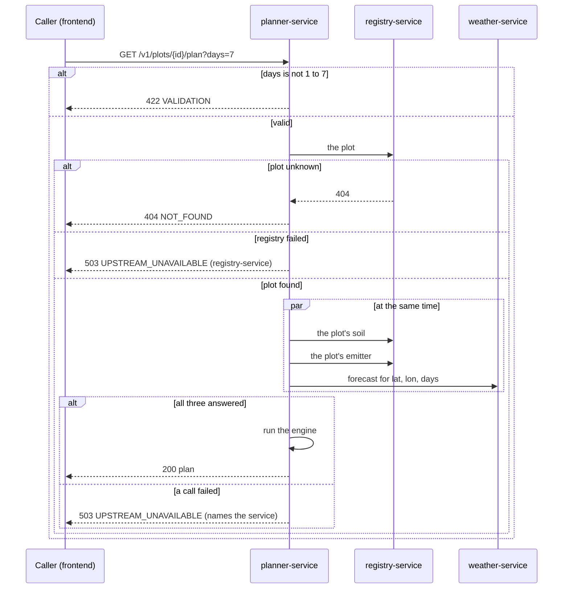

# planner-service

Builds a day-by-day irrigation plan for one plot: for each of the next days, how much water to apply (litres) and for how long to run the drip line (minutes). It has no database.

It combines two other services over HTTP:

1. **registry-service** gives the plot (crop, planting date, area, row and emitter spacing, coordinates), its soil (available water in mm per metre) and its emitter (flow in L/h).
2. **weather-service** gives the daily ET0 (how much water a standard grass patch loses, in mm) and rain (mm) for the plot's coordinates.

The planner then runs an irrigation engine (`engine.py`, plain arithmetic, no AI model) that follows the FAO-56 method. The formulas, units and approximations are in the skill [`irrigation-calc-reference`](../../.claude/skills/irrigation-calc-reference/SKILL.md); the research with the chapter and table for each claim is in [`docs/research/fao56.md`](docs/research/fao56.md).

The calling order: the planner first asks the registry for the plot (the other calls need its soil, emitter and coordinates). Then it asks the registry for the soil and the emitter and the weather service for the forecast, all three at the same time.

## Setup and run

```bash
cd services/planner-service
uv sync                    # creates .venv and installs dependencies
cp .env.example .env       # then edit the values if needed (never committed)
uv run uvicorn main:app --host 127.0.0.1 --port 8002
```

The service refuses to start, with a clear error naming the variable, if a required setting is missing or invalid. The registry (port 8000) and the weather service (port 8001) must be running for a plan to be answered.

## Endpoints

### `GET /v1/plots/{plot_id}/plan?days={days}`

`days` is a whole number from 1 to 7 and defaults to 7. The first day is today's local date at the plot's coordinates (the weather service's "today").

```json
{
  "plot_id": "c8f3d1b0-4d2e-5a1b-8b22-1d6e3f702002",
  "days": [
    { "date": "2026-11-18", "et0_mm": 2.76, "kc": 0.8, "litres": 0.0, "run_minutes": 0.0, "stale": false, "bucket_mm": 120.29 },
    { "date": "2026-11-19", "et0_mm": 3.07, "kc": 0.8, "litres": 0.0, "run_minutes": 0.0, "stale": false, "bucket_mm": 117.84 },
    { "date": "2026-11-20", "et0_mm": 3.17, "kc": 0.8, "litres": 0.0, "run_minutes": 0.0, "stale": false, "bucket_mm": 115.3 },
    { "date": "2026-11-21", "et0_mm": 3.09, "kc": 0.8, "litres": 0.0, "run_minutes": 0.0, "stale": false, "bucket_mm": 112.83 },
    { "date": "2026-11-22", "et0_mm": 2.65, "kc": 0.8, "litres": 0.0, "run_minutes": 0.0, "stale": false, "bucket_mm": 110.71 },
    { "date": "2026-11-23", "et0_mm": 2.74, "kc": 0.8, "litres": 0.0, "run_minutes": 0.0, "stale": false, "bucket_mm": 108.52 },
    { "date": "2026-11-24", "et0_mm": 2.57, "kc": 0.8, "litres": 0.0, "run_minutes": 0.0, "stale": false, "bucket_mm": 106.46 }
  ]
}
```

(A real answer from three running services on 2026-11-18, for the registry's sample "North block": tomato on loam, planted 2026-03-01.)

Check the first day by hand. The plot is long past its season, so `kc` is 0.8 (Kc end). The root zone holds `175 x 0.7 = 122.5` mm when full. The day's crop water use is `0.8 x 2.76 = 2.208` mm, so the bucket ends the day at `122.5 - 2.208 = 120.29` mm. The bucket is far above the stress limit (`RAW = 0.4 x 122.5 = 49` mm of depletion), so there is no irrigation: `litres` and `run_minutes` are 0.

- `et0_mm`: the forecast ET0 for the day (mm).
- `kc`: the crop coefficient for the day.
- `litres`, `run_minutes`: the irrigation planned for the day, for the whole plot. 0 on days without irrigation.
- `stale`: `true` when the weather service answered with an earlier forecast because its provider failed. It is set per day.
- `bucket_mm`: how much water is left in the root zone at the end of the day, after irrigation.

Rounding is for display only: `et0_mm`, `litres`, `run_minutes` and `bucket_mm` to 2 decimals, `kc` to 3. The calculation itself is not rounded.

### `GET /health`

`{"status": "ok"}`. It reports that the service is running. It does not call the other services.

### Errors

Every error is `application/problem+json` with a `code`.

| Status | `code` | When |
| --- | --- | --- |
| `422` | `VALIDATION` | `days` is not a whole number from 1 to 7. Also when the plot's crop is not in the planner's crop table. |
| `404` | `NOT_FOUND` | The plot does not exist (any id the registry does not know, including one that is not a UUID). Also an unknown route. |
| `503` | `UPSTREAM_UNAVAILABLE` | The registry or the weather service failed, or sent an answer the planner cannot trust. `detail` names the service, for example `weather-service is unavailable: ConnectError`. |
| `405` | `VALIDATION` | Wrong HTTP method |

The planner never returns a plan built on numbers it did not get: a missing or invalid value from an upstream service is a `503`, never a zero. If both services are down, the registry is reported first.

## How a plan is built

For each day of the forecast, in order. The formulas and their FAO-56 equations are in the skill; here they are in words. FAO-56 means FAO Irrigation and Drainage Paper 56 (Allen et al., 1998).

1. **Day number.** Days since planting, with the planting day as day 1.
2. **Crop coefficient Kc** (FAO-56 Ch. 6, Eq. 66). Kc says how much water the crop uses compared with the reference grass. The season has four stages (initial, development, mid, late) with a length in days for each. Kc is flat in the initial stage, rises in a straight line to `Kc mid` through development, is flat in mid-season, and falls in a straight line to `Kc end` in the late stage. After the last stage it keeps `Kc end`.
3. **Crop water use ETc** (Ch. 5, Eq. 56). `ETc = Kc x ET0`, in mm for the day.
4. **The bucket** (Ch. 8, Eq. 82 and 83). Think of the root zone as a tank. `TAW` (total available water) is how much it holds: soil water per metre x root depth. `RAW` (readily available water) is the part the crop can use before it is stressed: `p x TAW`. The planner tracks the depletion (how far below full the tank is) and reports the level, `TAW - depletion`, as `bucket_mm`.
5. **The daily rule** (Eq. 85 and 86). In this order:
   1. Rain first: the rain of the day lowers the depletion (never below 0: water above full is lost).
   2. If the depletion after rain plus today's ETc is **strictly greater** than RAW, irrigate in the morning enough to refill exactly the current depletion. Exactly at RAW does not irrigate.
   3. Subtract today's ETc. The depletion cannot pass TAW.
   4. The day's end is the next day's start.
6. **Litres.** The irrigation depth in mm over the plot's area: `depth x area` (1 mm over 1 m2 is 1 litre).
7. **Run minutes.** `depth x row spacing x emitter spacing / flow x 60`. Each emitter waters the rectangle of row spacing by emitter spacing, so the plot's area cancels out. This step is not from FAO-56 (see the approximations).

### The crop table

The planner knows two crops, the ones in the registry's sample data. The values are in `crops.py`, each with its FAO-56 table and a note when it is a choice rather than a printed value. **All of them are provisional, pending the instructor's answers** (`docs/p2-planner-questions-for-instructor.md`).

| Crop | `Kc ini` | `Kc mid` | `Kc end` | Stage days (ini / dev / mid / late) | Root depth | `p` |
| --- | --- | --- | --- | --- | --- | --- |
| `tomato` | 0.6 | 1.15 | 0.80 | 30 / 40 / 45 / 30 | 0.7 m | 0.40 |
| `bell-pepper` | 0.6 | 1.05 | 0.90 | 30 / 35 / 40 / 20 | 0.5 m | 0.30 |

Provisional choices, not printed values: `Kc ini` 0.6 is the Solanum group row (the tomato and pepper rows are blank); tomato `Kc end` 0.80 is the middle of the printed range 0.70-0.90; the pepper initial stage is printed "25/30" and read as 30; both root depths are the lower end of the printed range (FAO-56 notes that smaller values suit scheduling). Printed values: `Kc mid`, pepper `Kc end`, the other stage lengths and `p`.

The soils come from the registry (mm of available water per metre): sand 83, loam 175, clay-loam 200.

### Stated approximations

The plan is only as good as these assumptions. Each one is also in the skill.

- **A single Kc.** `ETc = Kc x ET0` with one coefficient per day. FAO-56 names the dual coefficient (separate soil evaporation) as better suited to drip; the weather service gives only ET0 and rain, so it is not used.
- **No climate adjustment.** Kc mid and Kc end are not adjusted for wind and humidity (the data is not available), and `p` is not adjusted for ETc. This can shift the crop water use by several percent in very dry, windy or humid places.
- **No wetted-fraction adjustment.** The initial Kc is not lowered for drip, which wets only part of the surface. This affects only the first weeks after planting.
- **No drip efficiency factor.** The litres are the water the crop needs, not what the pump must deliver. If the system loses 10 percent, the grower applies more.
- **All rain counts.** All forecast rain reaches the root zone. Real rain is partly lost to runoff and to the leaf cover, so on rainy days the plan may irrigate a little later than it should.
- **The bucket starts full.** The planner has no irrigation history, so day 1 begins with zero depletion. If the plot was in fact dry, the first irrigation will come later than it should.
- **A plot past its season keeps Kc end.** The planner does not know the crop was harvested. It keeps planning with the last Kc, as the sample plots show.
- **Fixed root depth.** The root depth does not grow over the season.
- **Each emitter serves row spacing x emitter spacing.** Not from FAO-56. The course's worked example confirms it: 1000 m2, rows 1.5 m, emitters 0.4 m, 1.0 L/h, 6900 L takes 248 minutes (`6.9 mm x 1.5 x 0.4 / 1.0 x 60 = 248.4`).

### A worked example

Case 1 of the skill, which the tests check against hand calculations: tomato in mid-season (Kc 1.15) on sand (83 mm/m), planted 2026-08-01, area 1000 m2, rows 1.5 m, emitters 0.4 m at 2.0 L/h, from 2026-10-20 with no rain.

`TAW = 83 x 0.7 = 58.1` mm. `RAW = 0.40 x 58.1 = 23.24` mm.

| Day | ET0 (mm) | ETc = 1.15 x ET0 | Depletion before | Depletion after ETc | Strictly more than RAW? | Irrigation (mm) | Litres | Run minutes | `bucket_mm` |
| --- | --- | --- | --- | --- | --- | --- | --- | --- | --- |
| 1 | 5.0 | 5.75 | 0 | 5.75 | no | 0 | 0 | 0 | 52.35 |
| 2 | 5.5 | 6.325 | 5.75 | 12.075 | no | 0 | 0 | 0 | 46.025 |
| 3 | 6.0 | 6.9 | 12.075 | 18.975 | no | 0 | 0 | 0 | 39.125 |
| 4 | 6.0 | 6.9 | 18.975 | 25.875 | yes | 18.975 | 18975 | 341.55 | 51.2 |

On day 4 the depletion would reach 25.875, past RAW (23.24), so the planner irrigates the 18.975 mm that is missing, and the day ends with only that day's 6.9 mm missing: `bucket_mm = 58.1 - 6.9 = 51.2`. Run minutes: `18.975 x 1.5 x 0.4 / 2.0 x 60 = 341.55`. Days 5 to 7 are in `tests/cases.py`.

## How a request is answered



- The plot's crop must be in the crop table, or the answer is `422`.
- The planner does not retry and does not cache: a failure is reported at once. The weather service already retries its provider and can answer with a stale forecast.
- Each call has its own timeout. `WEATHER_TIMEOUT_SECONDS` must be longer than the weather service's worst case (one provider attempt plus its retries and the pauses between them; see "How long can one request take?" in the [weather README](../weather-service/README.md)), or the planner gives up before the weather service can return its stale answer.

## Configuration (`.env`)

Read in `config.py` with pydantic-settings. Every variable is required. `.env` is never committed; `.env.example` has safe values.

| Variable | Meaning | Example |
| --- | --- | --- |
| `REGISTRY_URL` | Base URL of registry-service | `http://127.0.0.1:8000` |
| `WEATHER_URL` | Base URL of weather-service | `http://127.0.0.1:8001` |
| `REGISTRY_TIMEOUT_SECONDS` | Timeout for one registry call | `5` |
| `WEATHER_TIMEOUT_SECONDS` | Timeout for the weather call; must exceed the weather service's worst case | `30` |

## Files

| File | Purpose |
| --- | --- |
| `main.py` | The app, `/health` and the plan route |
| `planner.py` | Fetches the plot, soil, emitter and forecast, runs the engine, builds the response (rounding) |
| `engine.py` | The irrigation calculation (pure functions; no network, no clock) |
| `crops.py` | The crop table (provisional values with their FAO-56 sources) |
| `upstream.py` | The clients for the registry and the weather service, with strict checks of every field |
| `config.py` | Settings from `.env` |
| `errors.py` | Turns every error into `application/problem+json` |
| `docs/research/fao56.md` | The FAO-56 research: chapter and table for each claim |
| `tests/` | Test suite, including the three hand-calculated cases (`tests/cases.py`); both upstream services are fakes, so no test uses the network |

## Test

```bash
uv run pytest -q
```
