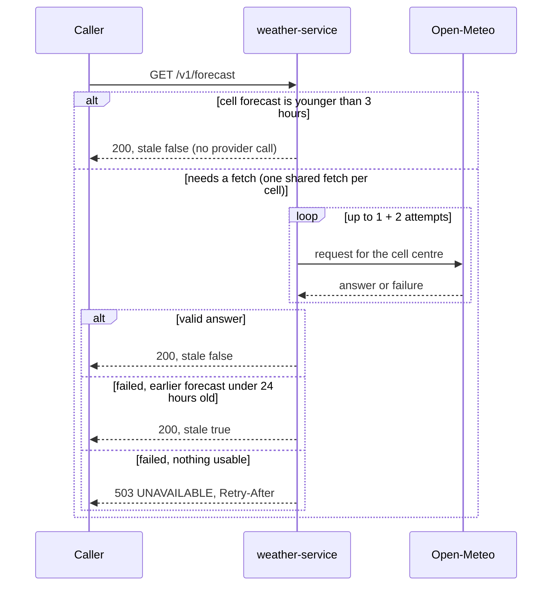

# weather-service

Serves the daily weather forecast the planner needs: for each of the next days, ET0 (how much water a standard patch of grass loses to sun and wind, in mm) and rain (mm). It fetches the numbers from [Open-Meteo](https://open-meteo.com/en/docs) (the provider), keeps them in memory, and answers the rest of the system.

The service knows coordinates and dates only. It knows nothing about farms, plots or crops. It has no database: the cache lives in the process memory, and a restart empties it.

## Setup and run

```bash
cd services/weather-service
uv sync                    # creates .venv and installs dependencies
cp .env.example .env       # then edit the values if needed (never committed)
uv run uvicorn main:app --host 127.0.0.1 --port 8001
```

The service refuses to start, with a clear error naming the variable, if a required setting is missing or invalid.

## Endpoints

### `GET /v1/forecast?lat={lat}&lon={lon}&days={days}`

All three parameters are required. `lat` is -90 to 90, `lon` is -180 to 180, `days` is a whole number from 1 to 7.

```json
{
  "lat": 31.25,
  "lon": 34.79,
  "source": "open-meteo",
  "fetched_at": "2026-11-16T09:20:09Z",
  "stale": false,
  "days": [
    { "date": "2026-11-16", "et0_mm": 2.71, "rain_mm": 0.0 },
    { "date": "2026-11-17", "et0_mm": 2.62, "rain_mm": 0.0 },
    { "date": "2026-11-18", "et0_mm": 2.53, "rain_mm": 0.0 },
    { "date": "2026-11-19", "et0_mm": 2.93, "rain_mm": 0.0 },
    { "date": "2026-11-20", "et0_mm": 3.04, "rain_mm": 0.0 },
    { "date": "2026-11-21", "et0_mm": 3.1, "rain_mm": 0.0 },
    { "date": "2026-11-22", "et0_mm": 2.31, "rain_mm": 0.3 }
  ]
}
```

(A real answer for the demo plot's coordinates, fetched on 2026-11-16.)

- `lat` and `lon` repeat what was asked.
- `fetched_at` is when the service got the forecast from the provider (UTC), not when you asked.
- `stale` is `true` when the provider failed and the answer is an earlier forecast (see below).
- `days` starts today. "Today" is the local date at the point (the provider's time zone for the coordinates).

### `GET /health`

`{"status": "ok"}`. It reports that the service is running. It does not call the provider.

### Errors

Every error is `application/problem+json` with a `code`.

| Status | `code` | When |
| --- | --- | --- |
| `422` | `VALIDATION` | A parameter is missing, not a number, or out of range (including `nan` and `inf`) |
| `503` | `UNAVAILABLE` | The provider failed and there is no usable earlier forecast. Has a `Retry-After` header. |
| `404` | `NOT_FOUND` | Unknown route |
| `405` | `VALIDATION` | Wrong HTTP method |

## How a request is answered



- **Cell:** two points in the same 0.1° cell share one forecast. A point is rounded down to the tenth (`31.3` is cell `31.3`), and the provider is asked for the cell's centre.
- **Fresh for 3 hours.** While fresh, there is no provider call.
- **Retries.** When the provider fails (timeout, error status, a body that is not JSON, or a missing or invalid field), the service tries again twice.
- **One fetch per cell.** If many requests need the same expired cell at once, they share one fetch and its outcome. A dead provider costs one retry chain, not one per request.
- **Nine days are fetched and kept**, whatever `days` was asked, so an earlier forecast still covers 7 days from today. Days already past are dropped from the answer.
- **No made-up numbers.** The service only returns numbers the provider gave. If a day or a value is missing, or a value is not a plain non-negative number in mm, the whole answer counts as a provider failure. It never fills in a zero or a default: a forecast of zeros would look like "no water needed".

### How old can a stale forecast be?

**24 hours** (`MAX_STALE_HOURS`). It covers an overnight outage, so a grower opening the app in the morning still gets a plan from the evening's forecast. Near-term forecasts keep most of their value for about a day. Past that, the rain information may be out of date enough to make a watering decision wrong, so the service answers `503` rather than a plan on old weather. This is a judgment call; the decision and its trade-off are in [`docs/judgment-log-p2.md`](../../docs/judgment-log-p2.md).

## The provider

Open-Meteo's free tier needs no API key. The daily variables used:

| Meaning | Open-Meteo variable | Unit |
| --- | --- | --- |
| ET0 (FAO-56 reference evapotranspiration) | `et0_fao_evapotranspiration` | mm |
| Rain (precipitation sum for the day) | `precipitation_sum` | mm |

The request also sends `forecast_days=9` and `timezone=auto` (so days are local days). The service checks that the answer says `mm` for both variables. These names exist only in `provider.py`; every other file sees plain `date`, `et0_mm` and `rain_mm`. Moving to another provider means rewriting that one file and changing `.env`.

### How long can one request take?

The provider timeout (`PROVIDER_TIMEOUT_SECONDS`) applies to each phase of one call (connect, read, write), not to the whole call. In the worst case a request waits for 1 + `PROVIDER_RETRIES` attempts plus the pauses between them before the service answers with its stale forecast or `503`. A caller (the planner) must set its own timeout longer than that, or it will give up before this service can return its stale answer.

## Configuration (`.env`)

Read in `config.py` with pydantic-settings. Every variable is required except the API key. `.env` is never committed; `.env.example` has safe values.

| Variable | Meaning | Example |
| --- | --- | --- |
| `PROVIDER_BASE_URL` | Provider's base URL | `https://api.open-meteo.com` |
| `PROVIDER_API_KEY` | Sent as `apikey` when not empty (paid plans); may be empty | (empty) |
| `PROVIDER_TIMEOUT_SECONDS` | Timeout for one provider call | `5` |
| `PROVIDER_RETRIES` | Extra attempts after a failure | `2` |
| `PROVIDER_RETRY_DELAY_SECONDS` | Pause between attempts | `0.5` |
| `FRESHNESS_HOURS` | How long a forecast is fresh | `3` |
| `MAX_STALE_HOURS` | How old a forecast can be and still be served as stale | `24` |
| `RETRY_AFTER_SECONDS` | Value of the `Retry-After` header on `503` | `60` |

## Files

| File | Purpose |
| --- | --- |
| `main.py` | The app and its two routes |
| `forecast.py` | The logic: cache, retries, shared fetch, stale fallback |
| `cache.py` | The 0.1° cell maths and the stored entries |
| `provider.py` | The Open-Meteo client and its strict validation (the only file that knows its field names) |
| `config.py` | Settings from `.env` |
| `errors.py` | Turns every error into `application/problem+json` |
| `tests/` | Test suite; the provider and the clock are fakes, so no test uses the network |

## Performance check (NFR-2.3)

A fresh forecast (no provider call) is answered with p95 at most 100 ms at 10 requests per second. The check is outside the test suite and uses a fake provider, so it does not depend on the internet. From the repository root:

```bash
services/weather-service/.venv/bin/python perf/run_weather_server.py &   # port 8011
k6 run --summary-export summary.json perf/weather_nfr_2_3.js
python3 perf/record_weather_results.py summary.json                      # writes perf/results/
```

Latest result (2026-11-16): **p95 2.76 ms**, 0.00% failed requests, 602 requests at 10 per second. See `perf/results/2026-11-16T092844Z_weather_v0.1.0.md`. The tooling has its own tests: `services/weather-service/.venv/bin/python -m pytest perf/tests/test_weather_perf.py -q`.

## Test

```bash
uv run pytest -q
```
